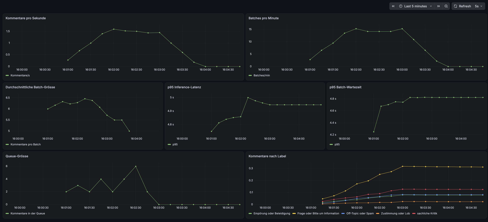

# 30Sekunden: Kommentar-Klassifikation

NLP-Inference-Service, der Leserkommentare der Online-Zeitung *30Sekunden* mit einer
Zero-Shot-Classification-Pipeline (`facebook/bart-large-mnli`) in Kategorien einteilt.
Anfragen werden per Microbatching gesammelt, Metriken über Prometheus bereitgestellt
und in Grafana visualisiert.



## Labels

Das Modell wählt für jeden Kommentar eines dieser Labels:

| Label | Zweck |
|---|---|
| sachliche Kritik | Begründeter Widerspruch zum Artikel |
| Zustimmung oder Lob | Positive Reaktionen |
| Frage oder Bitte um Information | Fragen, die die Redaktion beantworten kann |
| Sarkasmus oder Ironie | Nicht wörtlich gemeinte Kommentare |
| Empörung oder Beleidigung | Wichtigste Kategorie für die Moderation |
| Off-Topic oder Spam | Kommentare ohne Bezug zum Artikel |

Als Hypothese verwendet die Pipeline den Satz `"Dieser Kommentar ist {}."`.

> [!NOTE]
> **Grenzen des Modells**
>
> - `bart-large-mnli` wurde auf Englisch trainiert. Deutsche Kommentare werden
>   klassifiziert, aber weniger zuverlässig.
> - Im Loadtest wurde das Label "Sarkasmus oder Ironie" nie vergeben: Ironie lässt sich
>   ohne Training und Kontext kaum erkennen.

## Starten

Voraussetzung: Docker mit Docker Compose.

```bash
docker compose up --build
```

Beim ersten Start lädt der Classifier das Modell herunter (ca. 1.6 GB). Der Service ist
bereit, sobald im Log `Application startup complete` erscheint. Das Modell wird im
Volume `hf-cache` gespeichert, spätere Starts dauern nur wenige Sekunden.

| Service | URL |
|---|---|
| Classifier | http://localhost:8080 (API-Doku unter `/docs`) |
| Prometheus | http://localhost:9090 |
| Grafana | http://localhost:3000 (Login `admin` / `admin`) |

Das Dashboard *30Sekunden Kommentar-Klassifikation* ist in Grafana unter **Dashboards**
bereits eingerichtet.

## Testen

Einzelner Kommentar:

```bash
curl -s localhost:8080/classify --json '{"comment": "Wann gilt das?"}'
```

Antwort:

```json
{"comment": "Wann gilt das?", "label": "Frage oder Bitte um Information", "score": 0.5415}
```

Loadtest (nur Python-Standardbibliothek, keine Installation nötig):

```bash
python3 loadtest/loadtest.py --users 10 --duration 120
```

Die Metriken sind direkt unter http://localhost:8080/metrics/ einsehbar.

## Microbatching

Der Endpoint `POST /classify` klassifiziert einen Kommentar nicht sofort, sondern legt ihn
in eine Queue (`app/batcher.py`) und wartet auf das Resultat:

1. Jede Anfrage legt ihren Kommentar zusammen mit einem Future und dem Ankunftszeitpunkt
   in eine `asyncio.Queue`.
2. Ein Worker im Hintergrund wartet auf den ersten Kommentar. Mit dessen Ankunft startet
   das Batch-Zeitfenster.
3. Der Worker sammelt weitere Kommentare, bis entweder das Zeitfenster abgelaufen ist
   (200 ms) oder die maximale Batch-Grösse erreicht ist (8 Kommentare).
4. Der ganze Batch wird in einem einzigen Modell-Aufruf klassifiziert. Der Aufruf läuft in
   einem eigenen Thread, damit der Server währenddessen weitere Anfragen annimmt.
5. Jedes Resultat wird über sein Future an die wartende Anfrage zurückgegeben.

Zeitfenster und Batch-Grösse sind in `docker-compose.yml` über die Umgebungsvariablen
`BATCH_WINDOW_MS` und `MAX_BATCH_SIZE` einstellbar.

## Metriken

| Metrik | Typ | Bedeutung |
|---|---|---|
| `comments_classified_total` | Counter | Anzahl klassifizierter Kommentare. Als Rate: Durchsatz in Kommentaren pro Sekunde. |
| `batches_processed_total` | Counter | Anzahl verarbeiteter Batches. |
| `batch_size` | Histogram | Grösse der Batches. Liegt der Durchschnitt nahe bei 8, ist der Service stark ausgelastet; nahe bei 1 kommen die Anfragen einzeln. |
| `batch_inference_duration_seconds` | Histogram | Dauer des Modell-Aufrufs pro Batch. Zeigt, wie teuer die Inference ist. |
| `batch_wait_time_seconds` | Histogram | Zeit eines Kommentars in der Queue, bis sein Batch startet. Steigt sie deutlich über das Zeitfenster, kommt das Modell nicht nach. |
| `microbatch_queue_size` | Gauge | Anzahl wartender Kommentare. Ein dauerhaftes Wachstum bedeutet Überlast. |
| `comments_classified_by_label_total` | Counter | Klassifizierte Kommentare pro Label. Zeigt, welche Art von Diskussion gerade entsteht. |

Prometheus fragt `/metrics` alle 5 Sekunden ab (`prometheus/prometheus.yml`).

## Projektstruktur

```
app/
  labels.py          Labels und Hypothese
  classifier.py      Zero-Shot-Pipeline
  batcher.py         Microbatching
  metrics.py         Prometheus-Metriken
  main.py            FastAPI-App mit /classify und /metrics
loadtest/loadtest.py Loadtest
prometheus/          Prometheus-Konfiguration
grafana/             Datasource, Dashboard-Provider und Dashboard-JSON
docs/dashboard.png   Screenshot des Dashboards
```
